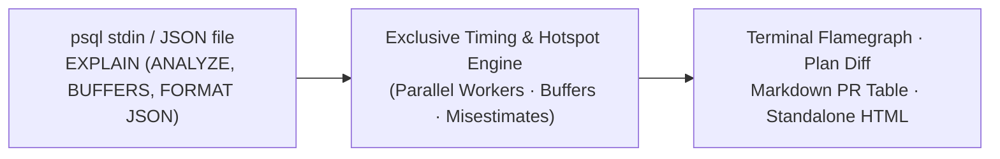

# planflare

**100% offline PostgreSQL `EXPLAIN (ANALYZE, BUFFERS, FORMAT JSON)` flamegraph, hotspot detector, and before/after plan diff CLI with zero runtime dependencies. Stop pasting production query plans into third-party websites.**

[](./LICENSE)
[](https://nodejs.org)
[](#architecture)

---

## Try It in 1 Second (Zero Setup)

```bash
npx planflare --demo
```

Analyzes a realistic before/after PostgreSQL query plan offline: flags a `Seq Scan on orders` (`est 120 vs actual 842,100`, `7,017.5x` row misestimate) plus a `38,560 kB` external disk sort, then diffs the indexed fix (`1,840.20 ms -> 4.20 ms`, `-99.8%`).

---

## Quick Start

```bash
# Pipe directly from psql (100% offline, zero DB locks, zero third-party uploads)
psql -XAtc "EXPLAIN (ANALYZE, BUFFERS, FORMAT JSON) SELECT * FROM orders WHERE tenant_id = 42" | npx planflare

# Analyze a saved plan and export a standalone offline HTML flamegraph
npx planflare slow-plan.json --html flamegraph.html

# Compare before vs after an index migration and copy a Markdown PR table
npx planflare diff before.json after.json --markdown
```

---

## Automated Hotspot Detection

`planflare` computes exclusive vs. inclusive per-node timings (accounting for `Actual Loops` and parallel workers) and flags 5 production hotspots automatically:

- **`LARGE_SEQ_SCAN`:** Sequential scans touching `>= 10,000` rows or `>= 15%` of total query time.
- **`ROW_MISESTIMATE`:** Planner cardinality off by `>= 10x` (critical at `>= 100x`).
- **`DISK_SPILL`:** External disk sorts (`Sort Space Type: "Disk"`) or temp block spills.
- **`LOW_BUFFER_HIT`:** Shared buffer hit ratio below `80%` with significant disk reads.
- **`HIGH_FILTER_REMOVAL`:** Filters discarding `>= 5,000` rows and `> 2x` more rows than returned.

---

## Honest Comparison

| Feature | `planflare` | `dalibo/pev2` / `depesz` | `pganalyze` |
|---|---|---|---|
| **100% offline / zero cloud uploads** | **Yes** (stdin/file CLI) | Browser paste sites | Cloud SaaS |
| **Before/after plan diff + Markdown PR summary** | **Yes** (`planflare diff`) | Manual tabs | Paid monitoring |
| **Zero database permissions / zero locks** | **Yes** | Yes | Collector agent |
| **Where alternatives win** | (Fast offline terminal & PR diffs) | Rich browser visual graph exploration | Continuous production telemetry & automated index advisor |

---

## Architecture



## License

[MIT](./LICENSE)
